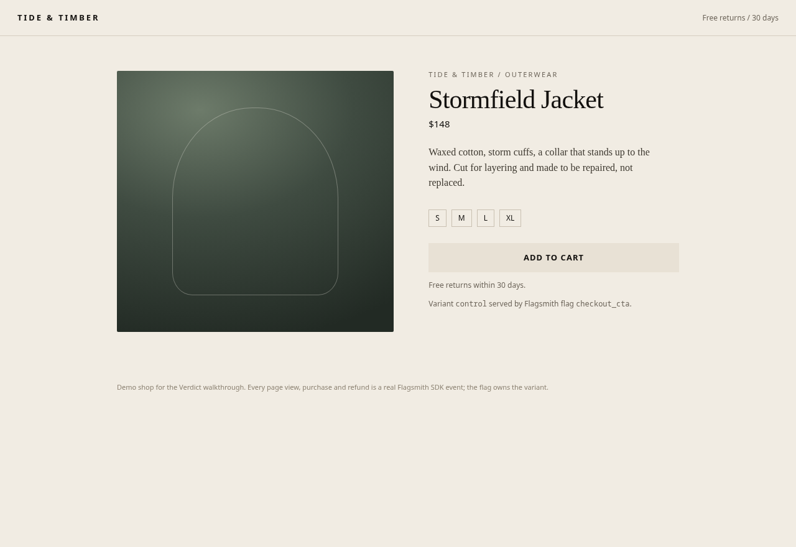
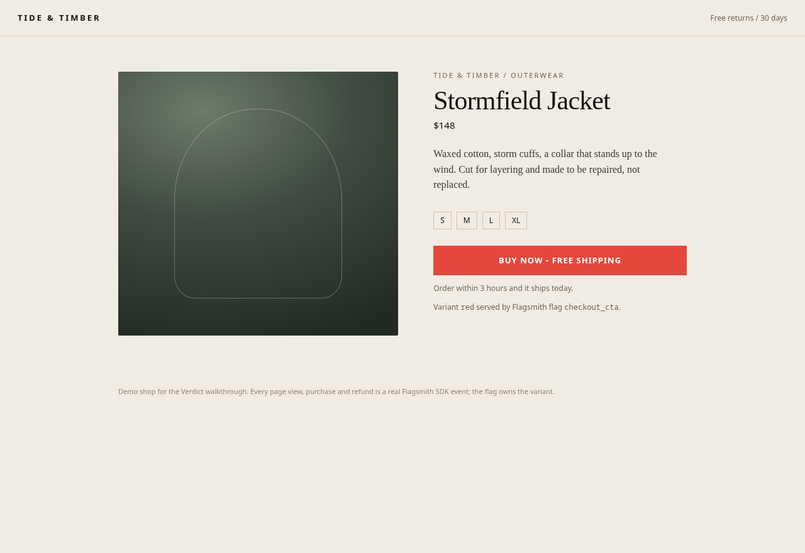
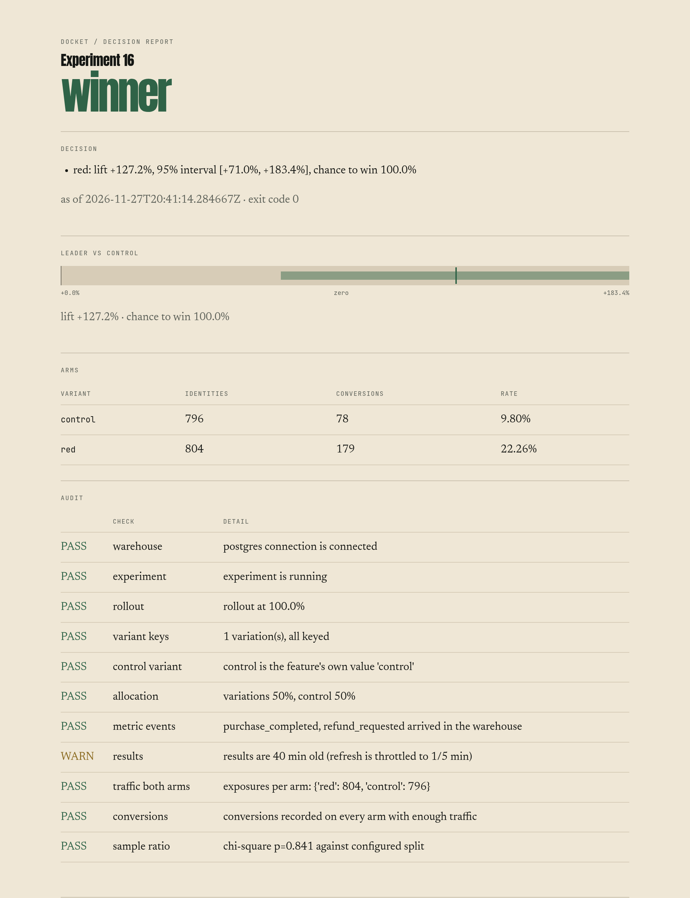

# Verdict

**Release gates for Flagsmith experiments.** Audit the wiring, refuse to ship on
noise, and roll the winner out with a decision record that says why.

Flagsmith tells you a win probability. Verdict tells you whether you are
*allowed to ship*, and refuses with the numbers when you are not.

```
$ verdict gate

VERDICT: INCONCLUSIVE  (exit 1)
  leading variant: red
  - red: lift +17.6%, 95% interval [-52.6%, +87.9%], chance to win 68.9%
  - interval still crosses zero; not enough traffic to call it
  rough extra identities needed on the leader: ~1783
```

Built for **Toggle Wars, Track 03** (build on open-source Flagsmith), November 2026.
MIT.

## The problem

A Flagsmith experiment page gives you a number and leaves the release decision to
whoever is awake. That fails in three documented ways:

1. **The instrumentation lies silently.** A variation with no key records no
   exposures; an SDK pointed at Flagsmith Cloud sends self-hosted events nowhere;
   a mistyped event name leaves conversions at zero. The dashboard still looks
   healthy.
2. **A point estimate is not a decision.** An interval that crosses zero is not a
   win, whatever colour the number is, and the free OSS tier has no approval
   workflow to stop a merge.
3. **The decision evaporates.** Nothing records who shipped what, on which numbers,
   with which flag mutation.

Verdict closes all three on self-hosted Flagsmith: one small binary and one
GitHub Action.

## What it does

| Command | What happens |
|---|---|
| `verdict audit` | Checks the experiment's wiring before you trust a number: warehouse connected, rollout live, every variation keyed, control identifiable, every metric event present in the warehouse, events URL pointed at your instance, both arms receiving traffic, conversions firing, sample ratio sane. Each failure prints the fix. |
| `verdict gate` | Reads the experiment's own results and returns one of seven states with the numbers that produced it. Exit `0` is the only value that allows a release. |
| `verdict ship --confirm` | Only runs on `WINNER`: completes the experiment, writes the winning variation to 100%, and emits a JSON + Markdown decision record with the statistics and the exact flag mutation. Refuses a completed experiment. Add `--sign` to attest the record. |
| `verdict verify` | Checks a signed decision record against `$VERDICT_SIGNING_KEY`; any edit to a lift, interval, experiment id or flag mutation invalidates it. |
| `verdict report` | Writes one standalone HTML file you can attach to a PR: state, interval, arms, audit table, deep link into Flagsmith. |

### The seven states

A gate that cannot tell "not enough data" from "bad data" from "losing" will ship
on noise. States are evaluated in this order:

| State | Meaning | Exit |
|---|---|---|
| `unreachable` | API, auth, or results not computed yet | 3 |
| `broken` | sample ratio mismatch, dead arm, or no exposures: the data cannot be trusted | 2 |
| `collecting` | below the floors (50 identities and 5 conversions per arm); there is no result yet | 1 |
| `losing` | the treatment loses; do not ship | 2 |
| `guardrail` | the winner regressed another metric beyond tolerance | 2 |
| `inconclusive` | the interval still crosses zero, or the win probability is below the threshold; prints roughly how much more traffic is needed | 1 |
| `winner` | interval excludes zero in the expected direction, win probability above threshold, guardrails clean | 0 |

Invariants: never `winner` below the sample floor; never `winner` on a sample
ratio mismatch; `losing` and `winner` are mutually exclusive; every state carries
the numbers that produced it.

## Demo video

A two-minute walkthrough lives in the [demo-v1 release](https://github.com/LangerSword/verdict/releases/download/demo-v1/verdict-demo.mp4)
(1080p MP4, 6.3 MB): the audit catches three silent wiring failures, a guardrail
run refuses a 99% winner, the checkout experiment is gated and shipped, and the
Flagsmith side shows the feature state move to 100%.

The shoppers are scripted by `demo/load.py`; every experiment, exposure,
conversion, statistic and flag mutation is real self-hosted Flagsmith.

## Run the whole thing in one command

Requirements: Docker with Compose, Python 3.11+.

```bash
git clone https://github.com/LangerSword/verdict
cd verdict
make demo          # or: python3 demo/demo.py
```

If port 8080 is already taken, run `DEMO_PORT=8088 make demo`; the shop moves,
Flagsmith stays on 8000. The first run pulls the Flagsmith image and builds the
shop, so give it a few minutes.

`make demo` is the short version of the demo script. It:

1. starts self-hosted Flagsmith (official image, Postgres, task processor) on
   `http://localhost:8000`;
2. creates the admin and seeds two live experiments plus one deliberately broken
   fixture over the API;
3. starts the sample shop on `http://localhost:8080`, instrumented with the real
   Flagsmith Python SDK;
4. drives 1,600 simulated shoppers through each experiment, flushes the SDK's
   event buffer, and refreshes the statistics;
5. runs `audit` and `gate` for you and prints the verdicts.

What you should see, in order:

- the checkout experiment: **12/12 audit checks pass**, then `VERDICT: WINNER`
  with an interval that excludes zero;
- the express-checkout experiment: the primary metric wins, but the refund
  guardrail regressed, so `VERDICT: GUARDRAIL` and exit `2`;
- the broken fixture: **three blocks** — a keyless variation, a metric event that
  never arrived, and an events URL pointing at Flagsmith Cloud.

`ship` is deliberately **not** automatic:

```bash
verdict --config demo/verdict.toml ship --confirm --record demo/decision.json
```

Open `http://localhost:8000` (admin `admin@demo.local`, password `demo-password`)
to watch the feature weight move to the winner, and `http://localhost:8080` to see
the shop serve the two variants.

The demo traffic is a fixture: the shop is a sample app and the shopper
conversion/refund probabilities are inputs to `demo/load.py`. The experiments,
exposures, conversions, statistics and flag mutation are all real Flagsmith. The
rates are printed; nothing about the numbers is hidden. `python demo/demo.py
--staged` first shows a `COLLECTING` refusal and waits out Flagsmith's five-minute
result-refresh throttle before the winner.

 

<p align="center"></p>

## How Flagsmith is used

This is not a dashboard or a wrapper around one GET. Verdict is the release
control for a Flagsmith experiment:

- **Experiment results are the decision input.** `GET
  /api/v1/environments/{env}/experiments/{id}/results/` returns per-variant
  sufficient statistics, relative lift, the credible interval, win probability,
  exposure timeseries and SRM. Verdict pre-registers the decision rule and only
  allows a release when those numbers clear it. Delete Flagsmith and there is
  nothing to decide.
- **The experiment's wiring is audited through Flagsmith's own objects:** warehouse
  connection and warehouse event names, feature variations and keys, rollout
  allocations, metric definitions, and the results snapshot's `as_of`.
- **The flag mutation is the release.** `ship` calls the experiment's `complete`
  endpoint and writes the winning variation to `100%` through the environment
  feature state. The decision record names the exact mutation.
- **The sample app uses the real SDK.** `demo/app.py` evaluates the flag with
  `flagsmith.get_identity_flags()`, sends `$flag_exposure` with the variant key
  the SDK resolved, and sends purchase/refund events with the same identifier. It
  flushes the buffer on shutdown; nothing is hand-written into the database.

Free OSS Flagsmith has no change-request or approval workflow — `POST
.../create-change-request/` returns `405` on the free image, and scheduled changes
are paid-only. Verdict gives the free tier the one thing it lacks for real
experiment-driven releases: a defensible yes or no, and a record.

## Use it against your own instance

```bash
pipx install "git+https://github.com/LangerSword/verdict"
# or
pip install "git+https://github.com/LangerSword/verdict"

export VERDICT_TOKEN=<API token from your Flagsmith user>
verdict init            # asks three questions, verifies the connection, writes verdict.toml
verdict audit           # check the wiring before trusting a number
verdict gate            # the decision, with exit codes for CI
verdict ship --confirm  # refuses unless the verdict is WINNER
verdict report          # standalone HTML
```

`VERDICT_TOKEN` is read from the environment; the tool never writes a secret to
disk. `VERDICT_EMAIL` / `VERDICT_PASSWORD` work as an alternative for local use.
Python 3.11+; no runtime dependencies outside the standard library.

### Configuration

`verdict init` writes `verdict.toml`. Edit it by hand at any time:

```toml
[flagsmith]
base = "http://localhost:8000"
environment = "<environment key>"

[experiment]
id = 7
dashboard = "http://localhost:8000"

[rule]
n_min = 50                 # identities per arm before a result exists
c_min = 5                  # conversions per arm
win_threshold = 0.95       # Flagsmith's own "winning" line
expected_direction = "increase"   # or "decrease"
weights = { control = 50, red = 50 }  # optional; derived from the rollout if absent

guardrails = [
  { metric_id = 2, name = "refund_requested", expected_direction = "not_increase", tolerance = 0.0 },
]
```

Guardrail tolerance is **relative lift**, matching the interval Flagsmith
returns: `tolerance = 0.02` allows a 2% relative increase before blocking. A
`not_decrease` guardrail blocks when the interval's upper bound is below zero.
The first metric on the experiment is the primary; guardrails are declared by
metric id. An unmeasured guardrail is never treated as a pass.

### Results are snapshots, not a live query

Flagsmith computes experiment statistics asynchronously and throttles refreshes
to once per five minutes. Verdict treats the stored payload as a snapshot keyed
by `as_of` and never pretends otherwise. The audit warns when a snapshot is older
than 30 minutes. There is deliberately no polling loop in the gate.

## GitHub Action

```yaml
name: Release gate
on: pull_request

permissions:
  contents: read
  pull-requests: write

jobs:
  verdict:
    runs-on: ubuntu-latest
    steps:
      - uses: actions/checkout@v4
      - uses: LangerSword/verdict/action@v1
        with:
          base: ${{ secrets.FLAGSMITH_BASE }}
          token: ${{ secrets.FLAGSMITH_TOKEN }}
          env: ${{ vars.FLAGSMITH_ENV_KEY }}
          experiment: "42"
          events-url: ${{ secrets.FLAGSMITH_EVENTS_URL }}
```

The composite action installs the package, runs the audit, gates the release,
fails the job on anything that is not `winner`, and comments the verdict on the
pull request. The gate's exit code is the required status.

## Signed decision records

A decision record is only evidence if it cannot be edited after the fact. With a
signing key, `ship` writes an HMAC-SHA256 attestation over every field except the
signature itself:

```bash
export VERDICT_SIGNING_KEY="$(openssl rand -hex 32)"
verdict ship --confirm --sign --record demo/decision.json
verdict verify demo/decision.json
# DECISION RECORD: VALID
#   valid hmac-sha256 signature, key 4f9c2a1b8e77
#   state winner (exit 0), experiment 10
#   mutation feature 1 -> red at 100%
```

The record carries a public `key_id` fingerprint, never the key. Change a lift,
an interval, the experiment id or the flag mutation and `verify` exits 2. Archive
the JSON with the pull request or the deploy, and a later audit can prove the
decision was made on those exact numbers.

## How it is built

One Python package, five modules, stdlib HTTP:

```
verdict/
  client.py   Flagsmith API client: auth, results, warehouse, feature states
  rules.py    pure decision engine: seven states, SRM, guardrails, intervals
  checks.py   audit catalog, each check returns pass/warn/block with a fix
  attest.py   HMAC-SHA256 signing and verification of decision records
  report.py   human, JSON and standalone HTML output
  cli.py      audit | gate | ship | verify | report
demo/         sample shop, seeder, traffic driver, one-command orchestrator
action/       composite GitHub Action
tests/        34 engine, audit, attestation and fixture tests
```

The engine is pure and testable without network: typed errors map to exit codes,
retries happen on 5xx only and never on 4xx, the results refresh throttle is
respected, and `ship` is idempotent.

```bash
python3 -m pytest tests -q
```

## Where this goes

Verdict is the gate today. The gap underneath it is bigger: feature flags made
releases continuous, but nobody owns the **release decision** — evidence,
policy, mutation and an audit trail in one place. The roadmap is a release
decision layer: signed decision records (shipped), then a post-ship guard and
automatic rollback, policy-as-code, a release ledger, an OpenFeature adapter so
the same engine works beyond Flagsmith, and an agent-native CLI/MCP.

[Read the roadmap](ROADMAP.md).

## What it does not do

No dashboard, no traffic simulator as a product, no change-request clone, no
multi-experiment orchestration, no auto-ship. `ship` always requires `--confirm`
and records the mutation it performed. The demo shop is a fixture, clearly
labelled, and is not part of the installed tool.

## Licence

MIT. See [LICENSE](LICENSE).
